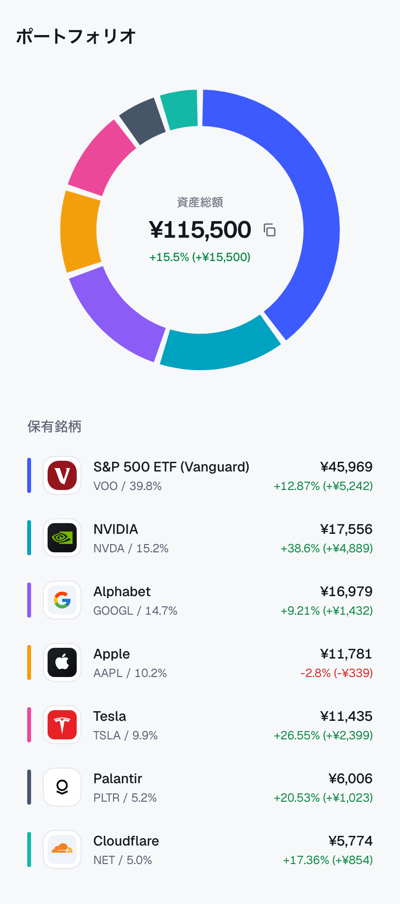
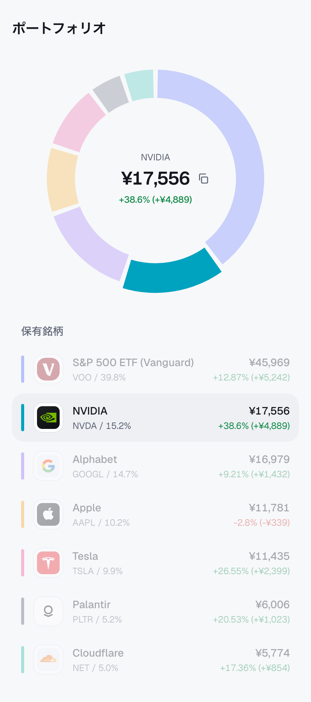
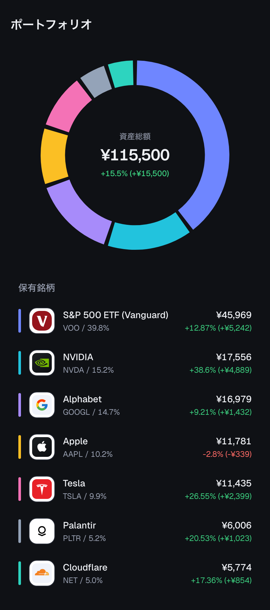

# ポートフォリオ表示アプリ

顧客の保有株式のポートフォリオを、ドーナツ型のパイチャートと保有銘柄の一覧で表示する Web アプリケーションです(Webフロントエンドエンジニア向けコーディング試験の提出物)。

| 通常表示                     | フォーカス時                           | ダークモード                          |
| ---------------------------- | -------------------------------------- | ------------------------------------- |
|  |  |  |

## 起動方法

```sh
pnpm install
pnpm dev
```

http://localhost:3000 で確認できます。Node.js 20.9 以上が必要です(開発は Node.js 24 で行いました)。

## コマンド

| コマンド                            | 内容                                                                            |
| ----------------------------------- | ------------------------------------------------------------------------------- |
| `pnpm dev`                          | 開発サーバーを起動する                                                          |
| `pnpm build` / `pnpm start`         | 本番ビルドと起動                                                                |
| `pnpm lint`                         | ESLint                                                                          |
| `pnpm format` / `pnpm format:check` | Prettier による整形 / 整形済みかの確認                                          |
| `pnpm typecheck`                    | TypeScript の型チェック                                                         |
| `pnpm test`                         | 単体テスト・コンポーネントテスト(Jest + React Testing Library)                  |
| `pnpm test:e2e`                     | E2E テスト(Playwright。初回のみ `pnpm exec playwright install chromium` が必要) |

## 技術構成

- **Next.js 16(App Router)/ React 19 / TypeScript(strict)**
- **Tailwind CSS v4** と CSS 変数によるデザイントークン(ダークモード対応)
- **Zod**: API レスポンスの実行時検証と型の生成
- **ESLint + Prettier**: Next.js 標準のルールに、書式は Prettier を組み合わせています
- **Jest + React Testing Library / Playwright**: テスト

パイチャートはグラフライブラリを使わず、SVG で自前実装しています。「12時起点・保有割合の降順・時計回り」「要素間の隙間」「フォーカス時の半透過と強調」「キーボード操作」をすべて意図どおりに制御するためです。

## ディレクトリ構成

機能単位でまとめる構成(feature-based)を採用しています。ポートフォリオ機能のコードは `src/features/portfolio/` に集約し、他の機能でも使える汎用的なものだけを `src/components/`・`src/utils/` に置いています。

```
src/
├── app/
│   ├── page.tsx                      # 画面の組み立てのみ
│   ├── globals.css                   # デザイントークン(CSS 変数)
│   └── api/portfolio/route.ts        # 課題のダミーレスポンスを返すモック API
├── features/portfolio/
│   ├── api/fetch-portfolio.ts        # API の呼び出しとレスポンス検証
│   ├── components/
│   │   ├── portfolio-screen.tsx      # データ取得と、読み込み中・エラー・表示の出し分け
│   │   ├── portfolio-view.tsx        # チャートと一覧のフォーカス状態を一元管理
│   │   ├── donut-chart.tsx           # SVG のドーナツチャート
│   │   ├── portfolio-summary.tsx     # チャート中央の表示
│   │   ├── holding-list.tsx / holding-list-item.tsx
│   │   └── gain-text.tsx             # 評価損益の表示(色と符号)
│   ├── hooks/use-portfolio.ts        # 取得状態の管理と再取得
│   ├── mocks/portfolio.json          # 課題で提供されたダミーレスポンス
│   ├── schemas.ts                    # Zod スキーマ(snake_case → camelCase への変換を含む)
│   └── utils/                        # 並び替え・チャートの角度計算・配色
├── components/asset-logo.tsx         # 読み込み失敗時に代替表示するロゴ
└── utils/format.ts                   # 金額・割合・符号の書式、損益の区分
```

## データの流れ

1. 画面はクライアント側で `GET /api/portfolio` を呼び出します(SPA)。モック API は課題のダミーレスポンスをそのまま返すため、実際の API に差し替えても取得側のコードは変わりません。
2. レスポンスは Zod で検証し、アプリ内では camelCase の型に変換して扱います。API の形が変わっても、影響は `schemas.ts` だけに閉じます。想定外のデータはエラー表示につながり、「再読み込み」で再取得できます。
3. 保有銘柄は保有割合の降順に並べ、チャートと一覧の両方で同じ順序・同じ色を使います。

## 仕様の解釈と設計判断

### パイチャート

- 12時の位置を起点に、保有割合の大きい順で時計回りに描画します。
- 各要素の角度は `holding_ratio` の合計で正規化して計算するため、合計がちょうど100%にならないデータでも円がずれません。
- ワイヤーフレームに合わせ、要素間に隙間を入れています。要素が1つだけの場合は隙間のない完全な円にし、非常に小さい要素も隙間で消えないようにしています。
- 配色は、損益の緑・赤と混同せず、隣り合う色が似ないように選んでいます。一覧の各行の左端にも同じ色を表示し、チャートとの対応がわかるようにしました。

### 評価損益の表示

- プラスは緑、マイナスは赤、ゼロはグレーで表示します。色だけに頼らず、`+` / `-` の符号を必ず付けています(色覚の多様性への配慮)。
- 表記はワイヤーフレームに合わせて `+15.5% (+¥15,500)` としました。割合は小数第1位〜第2位で表示します(例: `5.0%`、`12.87%`)。

### 保有銘柄の一覧

UI 要件の項目(ロゴ・銘柄名・ティッカー・評価損益額・評価損益率)に加え、ワイヤーフレームにある保有金額と保有割合も表示しています。ロゴ画像を読み込めなかった場合は、ティッカーの頭文字を代わりに表示します。

### フォーカスの挙動

UI 要件の「フォーカスされた要素以外をクリックされたらフォーカスを外す」は、次のように解釈しました。

| 操作                                         | 結果                                   |
| -------------------------------------------- | -------------------------------------- |
| チャートの要素をクリック                     | その銘柄をフォーカスする               |
| フォーカス中の要素を再度クリック             | フォーカスを外す                       |
| 別の要素をクリック                           | その要素にフォーカスを移す             |
| 要素以外(背景・余白・チャート中央)をクリック | フォーカスを外す                       |
| 一覧の行をクリック(追加)                     | チャートと同じくフォーカスを切り替える |
| Esc キー(追加)                               | フォーカスを外す                       |

別の要素をクリックしたときは、解除してから選び直す手間がないよう、そのままフォーカスを移すことにしました。

フォーカス中は、チャート・一覧の両方でフォーカス以外の銘柄を半透過にし、フォーカスした要素は少し拡大して強調します。さらに、チャート中央の表示をその銘柄の保有金額・評価損益に切り替えます(要件外の追加)。

### ホバー

クリックできることが伝わるよう、マウスを乗せたチャートの要素は少し拡大して明るくなります。半透過中の要素も、ホバーで少し濃くなり、選び直せることを示します。ホバーの表現は `@media (hover: hover)` の環境だけで有効になるため、スマートフォンでタップした後に強調が残ることはありません。

チャートの各要素は、**見た目の図形**と、**クリック・ホバーを受ける透明な図形**を重ねた構成にしています。見た目の図形をそのまま判定に使うと、要素の内側の縁にカーソルがあるときに「拡大 → カーソルが外れる → 縮小 → 再びホバー」を繰り返してちらつくためです(E2E テストで発覚)。透明な図形は拡大しないので、当たり判定は常に元の形のままです。

### 連続クリック時のテキスト選択の防止

チャートの要素をすばやく続けてクリックすると、ブラウザの「ダブルクリックで単語選択・トリプルクリックで行選択」が働き、テキストを持たないチャートの代わりに、近くのテキスト(チャート中央の銘柄名など)が選択されていました。中央のテキストに `user-select: none` を付けるだけでは、選択が次に近いテキスト(一覧の見出し)へ移るだけで防げません。そのため、チャート全体で2回目以降のクリック(`event.detail > 1`)だけ、`mousedown` の既定動作(テキスト選択)を止めています。クリックによるフォーカスの切り替えはそのまま動きます。

### 金額のコピー(追加)

チャート中央のテキストは選択できない代わりに、金額の右にコピーボタンを置いています。表示中の金額(フォーカス中はその銘柄の金額)を表示どおりの形式(例: `¥115,500`)でコピーし、アイコンがチェックマークに変わります。コピーしてもフォーカス中の銘柄は解除されません。結果は画面に表示しない要素でスクリーンリーダーにも伝えます。

### 読み込み中の表示

モック API はすぐに応答するため、スケルトンを毎回出すと一瞬だけ表示されてちらつきます。そこで、スケルトンの表示を次のように制御しています(`useDelayedLoading`)。

- 読み込みが 200ms 以内に終われば、スケルトンを一度も出さずに内容を表示する
- 200ms を超えたらスケルトンを出し、一度出したら少なくとも 500ms は表示し続ける(出てすぐ消えるのを防ぐ)
- スケルトン・内容・エラー表示は、切り替わるときにフェードインする

実際の API のように応答が遅い場合の流れは、応答を 1 秒遅らせた E2E テストで確認しています。

### アクセシビリティ

- チャートの各要素はボタンとして扱い(`role="button"`・`aria-pressed`)、Tab キーで移動し、Enter / Space で操作できます。読み上げでは銘柄名と保有割合を伝えます。
- チャート中央の表示が切り替わったことは `aria-live` で読み上げます。コピー結果の読み上げと重ならないよう、画面に表示しない別の要素にまとめています。
- OS の「視差効果を減らす」設定(`prefers-reduced-motion`)が有効な場合は、アニメーションを止めます。

### レスポンシブ対応

スマートフォンを基準に縦一列で配置し、PC では中央寄せで最大幅を設けています。チャートは SVG の `viewBox` で画面幅に合わせて伸縮します。スマートフォンで横スクロールが発生しないことを E2E テストで確認しています。

## テスト

| 種類                           | 対象                                                                                                                                                                                                                                                        |
| ------------------------------ | ----------------------------------------------------------------------------------------------------------------------------------------------------------------------------------------------------------------------------------------------------------- |
| 単体テスト                     | 書式(金額・割合・符号)、損益の区分、降順ソート、角度計算(12時起点・時計回り・正規化・隙間・一周分の要素)、API レスポンスの検証、スケルトンの表示タイミング                                                                                                  |
| コンポーネントテスト           | 中央表示、一覧の表示項目と順序、フォーカスの挙動(上の表の各操作)、読み込み中・エラー・再読み込み、ロゴ読み込み失敗時の代替表示、金額のコピー                                                                                                                |
| E2E テスト(PC・スマートフォン) | API からの表示、最大の銘柄が12時から時計回りに描かれること、クリックでの半透過(実際の CSS の値)と解除、ホバー、連続クリックでテキストが選択されないこと、クリップボードへのコピー、応答が遅い場合のスケルトン、一覧からの操作、横スクロールが発生しないこと |

E2E テストは本番ビルド(`pnpm build && pnpm start`)に対して実行します。

## 開発について

開発には AI コーディングツール(Claude Code)を使用しました。設計判断・仕様の解釈はすべて自分で確認・決定し、上記のテストで動作を検証しています。
